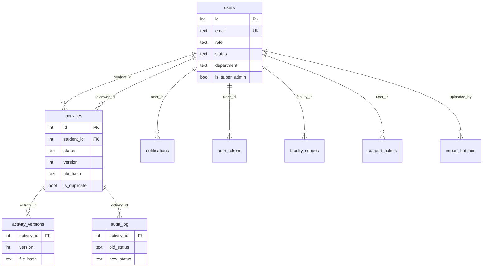

# SARP — Database and API Guide

The complete, always-current lists are generated from the code and the live database:

- [reference/database-schema.md](reference/database-schema.md) — every table, column, constraint, index, trigger
- [reference/api-routes.md](reference/api-routes.md) — every endpoint with its access rule

Regenerate both after any change: `cd backend && node scripts/gen-reference.js`.

## 1. Data model



| Table | Purpose |
|---|---|
| `users` | All accounts. `role` (student / faculty / admin), `status` (INVITED / ACTIVE / SUSPENDED), department, programme, enrollment or employee ID, `is_super_admin`, photo reference, theme preference. Constraints: unique email; `ACTIVE` requires a password; Super Admin must be an admin. |
| `activities` | The current state of one activity: details, status, current version, reviewer and remarks, proof reference and SHA-256 `file_hash`, duplicate flag. |
| `activity_versions` | One row per submission of an activity (v1, v2, …), each with its own proof and digest, so a correction never overwrites history. |
| `audit_log` | Append-only: one row per status change. Triggers reject UPDATE/DELETE. |
| `admin_audit_log` | Append-only record of administrative actions. Triggers reject UPDATE/DELETE. |
| `auth_tokens` | Activation and password-reset tokens: only the SHA-256 hash is stored; purpose, expiry, single-use timestamp, who issued it. |
| `import_batches` | Each roster import with counts and row-level errors, for history and for re-issuing activation links. |
| `faculty_scopes` | Which departments a faculty member may verify (a `NULL` department means all). |
| `notifications` | In-app notifications per user. |
| `support_tickets` | Support requests with a generated reference (`SUP-000123`), status, and admin-only notes. |
| `departments`, `programmes`, `categories`, `academic_sessions` | Reference data managed by administrators (active/inactive, one current academic year). |
| `schema_migrations` | Which migrations have run. |

## 2. Migrations

Files in `backend/src/migrations`, applied in order at API start and recorded in `schema_migrations`. They are additive (`CREATE … IF NOT EXISTS`, `ADD COLUMN IF NOT EXISTS`), so re-running is safe and existing data is kept.

| Migration | Adds |
|---|---|
| 001 baseline | users, activities, audit log, notifications, categories, sessions, departments |
| 002 user status | INVITED / ACTIVE / SUSPENDED |
| 003 onboarding | tokens, import batches, admin audit log (immutable) |
| 004 faculty scope | faculty scopes, Super Admin flag |
| 005 activity lifecycle | versions, activity date, immutable audit log |
| 006 academic management | programmes, archived sessions |
| 007 notifications | read timestamp, unread-lookup index, type and link rules |
| 008 profile photo | photo columns |
| 009 theme preference | `theme_preference` |
| 010 support tickets | `support_tickets` |

**Before upgrading a database that already holds real data, take a backup** (`pg_dump`), because migrations alter tables.

## 3. API conventions

- JSON in and out; `Authorization: Bearer <JWT>` on everything except the public auth routes and `/health`. File uploads are `multipart/form-data`.
- Errors are `{ "error": "message" }` with a meaningful status (400 validation, 401 not signed in, 403 not allowed, 404 not found, 409 conflict, 410 closed, 429 rate-limited). Login portal mismatch also carries `code: "PORTAL_MISMATCH"`.
- Lists are paged and filtered by the database: `page`, `limit`, plus the filters named in the reference.
- Someone else's draft activity and someone else's support ticket return **404** (their existence is not revealed); other records outside your scope return **403**.
- Downloads (`/analytics/export/*`, `/portfolio/:id`, proofs) are streamed with `Content-Disposition`; the API exposes that header to the browser through CORS.

## 4. Login contract

```
POST /auth/login   { email, password, portal?: "student" | "faculty" | "admin" }
200 { token, user }
401 wrong email or password
403 { code: "ACCOUNT_SUSPENDED" | "ACCOUNT_NOT_ACTIVE" }   (only revealed after the password is verified)
403 { code: "PORTAL_MISMATCH" }   (role in the database differs from the chosen portal; no token)
400 portal is not one of the three keys (e.g. an array)
```

`portal` is optional for compatibility with API clients; the web app always sends it.
