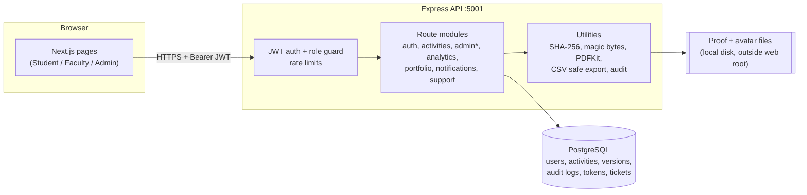
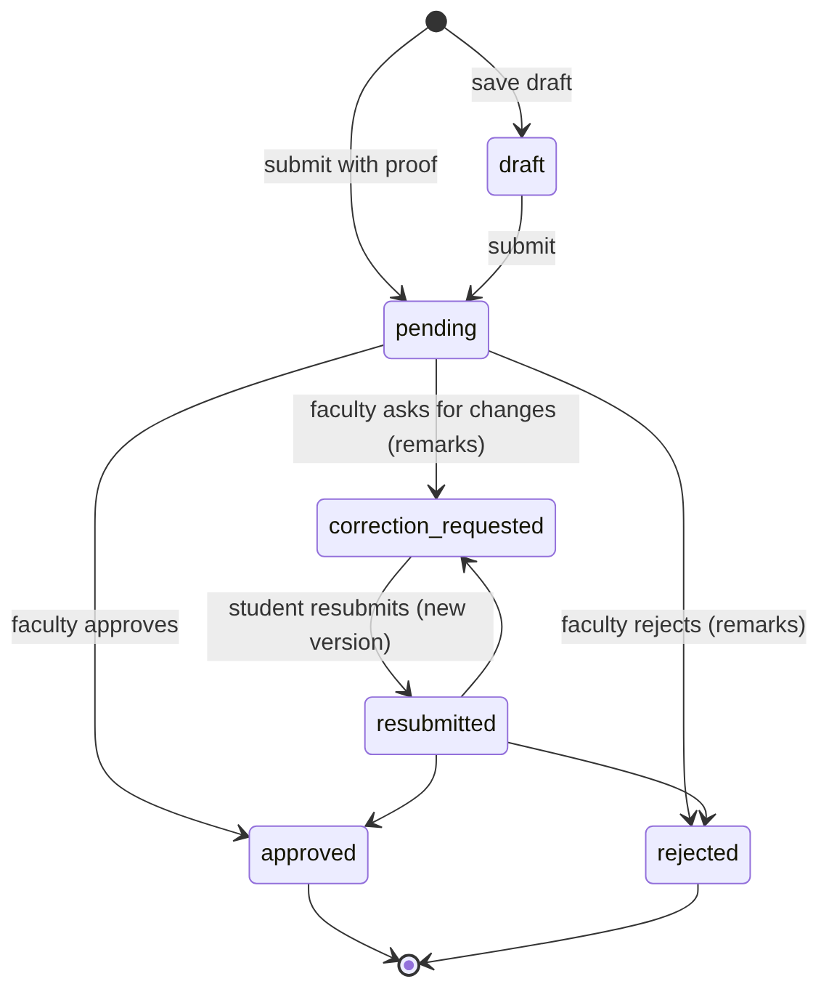

# SARP — Project Guide

## 1. Problem statement

Colleges ask students to show participation in hackathons, workshops, research, sports, volunteering and similar activities, but the evidence is scattered: certificates in chat groups, spreadsheets kept by departments, and no reliable way to tell a genuine record from an edited one. Faculty verify by memory or by forwarding files. Nothing records who approved what, when, and on what evidence. When a student needs a verified list (placements, scholarships, accreditation), someone rebuilds it by hand.

## 2. Solution

SARP is a web application with one shared record per activity:

1. A student submits the activity with a proof file.
2. The server stores the file outside the public web root and records its SHA-256 digest.
3. A faculty member inside the right verification scope reviews the evidence and approves, rejects, or asks for a correction (a reason is mandatory for the last two).
4. Each decision is written to an append-only audit log, and the student is notified.
5. Approved activities form the student's verified portfolio, which can be downloaded as a PDF. Faculty and administrators get filtered analytics and CSV/PDF reports.

Accounts are not self-created. An administrator imports the student roster (or creates faculty), and each person activates their own account through a one-time link.

## 3. Architecture

- **Frontend** — Next.js pages router. One app shell (sidebar + top bar) for signed-in pages, built from role-specific navigation. The login area is a separate, shell-less set of pages.
- **API** — Express. Every request passes through JWT verification, which re-reads the user from the database (role and status are never trusted from the token), then a role guard per route group.
- **Database** — PostgreSQL, versioned additive migrations (`backend/src/migrations`), applied automatically at start.
- **Files** — proof files and profile photos on local disk (`backend/uploads`), served only through authenticated endpoints.
- **Themes** — Light, Dark and System, applied before first paint; the choice is saved on the device and on the account.

## 4. Roles and access

| Role | Home | Navigation |
|---|---|---|
| Student | `/dashboard` | My activities, Verified portfolio, Notifications, Profile & settings, Contact & support |
| Faculty | `/faculty` | Verification center, Analytics & reports, Notifications, Profile & settings, Contact & support |
| Administrator | `/admin` | Overview, Users, Student import, Faculty, Academic setup, Support tickets, Audit log (+ Administrators for a Super Admin), plus the faculty review and analytics pages |

Rules enforced by the server, not the interface:

- A student only reads and changes their own activities; a student cannot approve anything.
- A faculty member only sees students inside their **verification scope** (all departments, or a named list). A scope that is empty shows nothing and says so.
- Only administrators manage accounts; only a Super Admin creates administrators or changes their level.
- Administrators cannot deactivate or demote themselves.

## 5. Authentication

- **Role-selection login.** `/login` offers Student Portal, Faculty Portal and Administrator Access. The chosen portal is sent with the login request, and the server compares it with the role stored in the database. A mismatch returns `403 PORTAL_MISMATCH`, issues no token and records no login. The portal choice can never grant a role.
- **Passwords** are hashed with bcrypt (12 rounds). Policy: 8–72 characters with at least one letter and one number, and not equal to the email or student ID.
- **Sessions** are JWTs (12 hours by default, `JWT_EXPIRES_IN`). Suspended or deactivated accounts are rejected on the next request. Password reset revokes existing sessions.
- **Rate limiting** on login (per IP and per IP+email), activation, reset and support tickets. It is in-memory, so it protects a single instance only.
- **Account states:** `INVITED` (no password yet, cannot sign in), `ACTIVE`, `SUSPENDED`. A database constraint prevents an `ACTIVE` account without a password.

## 6. Onboarding

1. **Student import (CSV).** The administrator uploads `student_id,name,email,department,programme,academic_year,semester`. A *preview* validates every row (formats, department and programme exist and are active, academic year looks like `2025-26`, semester 1–12, duplicates) and creates nothing. Confirming creates only the valid rows as `INVITED` students. The import and its rejected rows are kept in the import history and the admin audit log.
2. **Faculty and administrators** are created one by one (or faculty by CSV), also as `INVITED`. A faculty member's default scope is their own department.
3. **Activation.** The one-time link carries its token in the URL fragment (`#token=…`), so it is not sent to servers or logs. Only a SHA-256 hash of the token is stored; it expires (7 days by default), works once, and issuing a new link revokes older ones. The person sets a password and signs in.
4. **Delivery.** With SMTP configured the link is emailed. Without it, SARP sends nothing and says so; the administrator copies the link from the console (Users → Activation link, or Student import → Activation links) and hands it over. A student can also ask for activation from `/register`: the details must match the imported roster, and the response never reveals whether an account exists.
5. **Forgot password** works the same way (reset link, one use, 60 minutes by default).

## 7. Activity lifecycle and verification

- `draft` is private to the student and may lack a proof. `pending` needs a proof.
- Faculty decide from the review window: it shows the student, the submitted details, the SHA-256 digest, a duplicate warning if the same file was seen before, the earlier decisions on this activity, and an inline proof preview. Rejection and correction require remarks.
- Decisions run in a database transaction with a row lock. If two reviewers act at once, one wins and the other is told the record changed. If the student resubmitted while a reviewer had the old version open, approval of the stale version is refused and the window reloads.
- **Resubmission** creates a new *version*. Earlier versions, with their proofs, are kept and visible in the history.
- Students are notified of each decision; administrators are notified of new support tickets.

## 8. Document handling

- Accepted proofs: PDF, PNG, JPEG, WEBP, up to `MAX_PROOF_MB` (10 MB by default).
- The server checks the **file signature (magic bytes)**, not only the name or declared type, so a renamed executable is refused.
- Files are stored under random names outside the web root. They are streamed only to the owner, to faculty whose scope covers the student, and to administrators; the browser previews them as an authenticated blob.
- Profile photos (JPEG/PNG/WEBP) follow the same rules with a smaller size limit and are shown as initials when absent.

## 9. SHA-256 evidence digests

When a proof is uploaded the server computes the SHA-256 digest of the file bytes and stores it with the activity version. If the same digest already exists on another submission, the new activity is flagged `is_duplicate` and the reviewer sees a warning with a reference. The flag is a prompt for human review, not an automatic rejection (the same certificate can legitimately support two records, and a one-pixel edit changes the digest). The digest proves *the file is unchanged since upload*, not that the certificate is genuine — verification is the reviewer's job.

## 10. Audit

- `audit_log` records every status change (old status → new status, reviewer, remarks, version).
- `admin_audit_log` records administrative actions (imports, account creation, status and role changes, scope changes, academic setup, ticket handling).
- Both tables are protected by database triggers that reject `UPDATE` and `DELETE`, so the history cannot be quietly changed through the application. (A database superuser can still alter anything — see limitations.)
- The Audit log page is read-only and filterable by action, search text, target and date.

## 11. Analytics and reporting

- Filters: department, programme, category, status, academic year, semester and a date range; every figure and chart comes from the database for that filter, nothing is estimated.
- Charts: status mix, category distribution, department participation, monthly trend, semester statistics, academic-year comparison, pending-submission trend and faculty workload. Faculty only see their own scope.
- Reports: CSV (activities, by department, by semester) and PDF (institutional, department, semester). CSV cells that could be interpreted as spreadsheet formulas are neutralised; the PDF footer states the filters used.
- The student's **verified portfolio** PDF lists only approved activities with their dates, categories, reviewers and a proof-digest prefix.

## 12. Other features

- **Notifications** — bell with unread count, full page with filters.
- **Profile** — name, photo (preview, replace, remove), password change, theme (Light / Dark / System).
- **Contact & Support** — a ticket form (category, subject, message). Students and faculty see only their own tickets and status. Administrators triage tickets (Open / In progress / Resolved) with internal notes that are never sent to the ticket owner. A real support email address is shown only if configured.

## 13. Install and run

See the [README](../README.md) and the [final report](FINAL_REPORT.md#6-exact-startup-instructions).

## 14. Known limitations

Listed honestly in the [final report](FINAL_REPORT.md#5-known-limitations-and-production-checklist).
